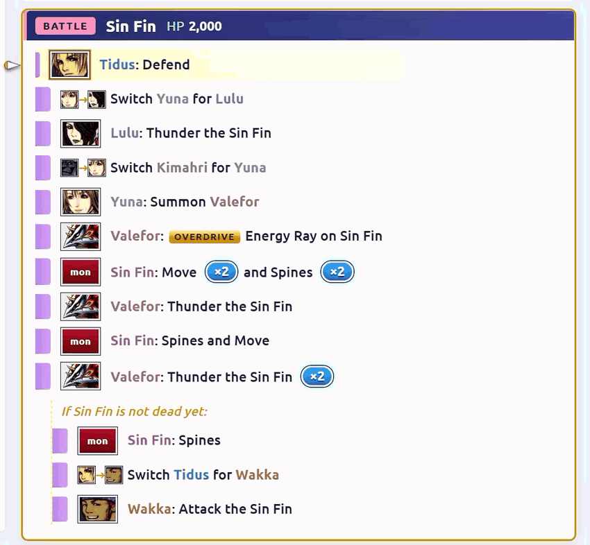
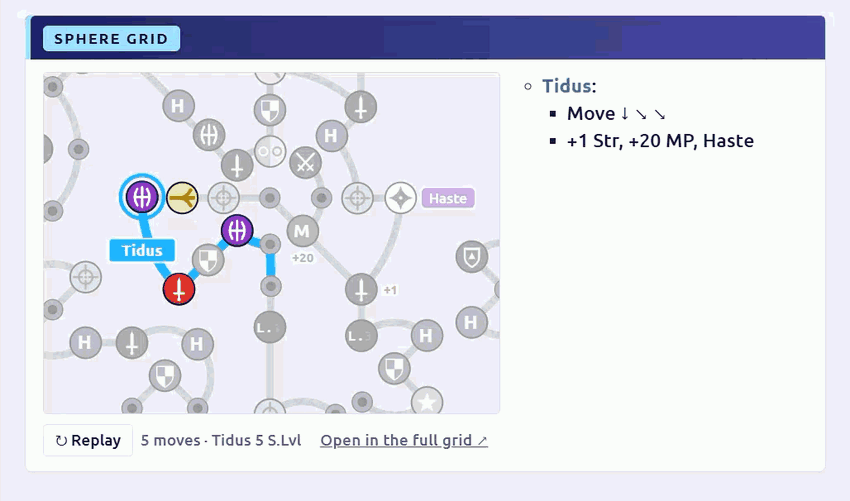
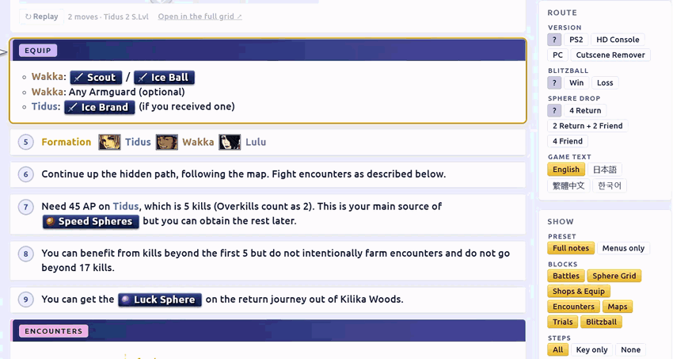

# Final Fantasy X Speedrun

A home for the **Final Fantasy X** speedrunning community.

**Visit the site: <https://lukeroddis.github.io/FFX-Speedrun/>**

## What's on the site

- **Run Notes** for each category, step through the notes with an FFX-inspired UI:

<p align="center">
  
</p>

- **Sphere Grid routes**, animated on a recreated Sphere Grid, step by step:

<p align="center">
  
</p>

- **Customise the Notes:** Filter and change the notes based on your category (PS2, PC, etc) and language, and key moments during the run (such as Blitzball win or loss):

<p align="center">
  
</p>

- **Skips:** a library of the skips the speedrun uses, with written guides and credited videos.
- **Leaderboards** and the latest runs pulled from speedrun.com.
- **Who's live** on Twitch: watch streams on the site, side by side for a race, and share a link that opens them ready to play.
- **Tools** highlighting third-party tools built by the Final Fantasy X speedrunning community, as well as in-house tools for building Sphere Grid routes and tracing maps.

## Contributing

Everything on the site is made from small text files, so you can help without any coding: edit a file on GitHub (the ✏️ pencil icon on any file), then choose **Propose changes** to open a pull request. Spotted a mistake but don't want to fix it yourself? [Open an issue](https://github.com/lukeroddis/FFX-Speedrun/issues).

### Writing notes

The notes are Markdown files, one per area, in `notes/<category>/<language>/`. For example, `notes/any/en/03-besaid.md` is the English Any% notes for Besaid. Each file is a list of numbered steps, with blocks for battles, encounters and more:

```markdown
# Besaid

1. CS (0:30), SD, FMV. Swim to the beach and SD.
2. Walk to the temple. Talk to the Priest, **CS (1:30)**.

:::encounters
- Piranhas: Tidus: Attack
- Otherwise: Flee
:::
```

- **Bold** marks a key step, which stays visible when runners hide the rest.
- Write item names normally (*Luck Sphere*, *Arctic Wind*). The site adds their icon and game-language name by itself.
- Show a map with `:::map Kilika Woods` … `file: kilika-woods` … `:::`. Make new maps with the [Map Editor](https://lukeroddis.github.io/FFX-Speedrun/tools/map-editor.html).
- **Translating:** copy the `en/` folder to your language's code (`fr/`, `ja/`…) and translate as much as you like. Untranslated areas show in English until they're done.

The [developer guide](DEVELOPER_GUIDE.md#writing-the-notes) covers everything else: battles, route toggles, maps, the item-name glossary and Sphere Grid routes.

### Adding/Editing a skip

Each skip is one Markdown file in `hub/skips/`, which becomes its own page on the site. Copy an existing one, such as `hub/skips/clasko-skip.md`, and change the details at the top:

```markdown
---
name: Clasko Skip
area: Mushroom Rock Road
categories: [any]
difficulty: 2
summary: Speak to the green Crusader, who pushes you to the cutscene.
video: https://www.youtube.com/watch?v=…
by: Who made the video
---
## What it does

The written guide, in Markdown.
```

[`hub/skips/README.md`](hub/skips/README.md) lists every field, and how to add images and version-specific steps.

### Other things you can change

| To change… | Edit |
|---|---|
| The Discord, speedrun.com or GitHub links | `hub/links.yml` |
| Which streams count as speedruns (title keywords, runners to always show, titles to leave out) | `hub/twitch.yml` |
| The leaderboards shown | `hub/leaderboards.yml` |
| The Tools page | `hub/tools.yml` |
| The categories | `notes/categories.yml` |

## For developers

The [developer guide](DEVELOPER_GUIDE.md) has the folder layout, how to run the site locally, every file format, and how the Twitch live check is set up.

## Licence

The notes, guides and route data are under [CC BY-SA 4.0](https://creativecommons.org/licenses/by-sa/4.0/), and the code is under the [MIT licence](LICENSE). By contributing, you agree to license your changes the same way. [LICENSE-CONTENT.md](LICENSE-CONTENT.md) says which files each covers, and what neither covers (Square Enix's material, others' videos, the font).

## Credits

- **Final Fantasy X**, character names, logos, and related imagery are registered trademarks and copyright material of Square Enix Co., Ltd. This is an unofficial, community-driven speedrunning resource and fan site. It is not affiliated with, endorsed by, or sponsored by Square Enix.
- The Sphere Grid layout was traced with reference to the Sphere Grid map by **Zomgmeister**.
- Skip videos are credited on each skip's page.
