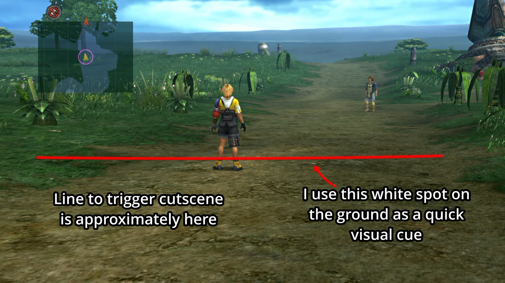

## Summary

On the first screen of Mi'ihen Highroad, at the end of the road there is a cutscene introducing the Chocobo Knights.

Much of this can be skipped if you speak to the man in blue as you enter the cutscene, as you gain the freedom to move around while the cutscene is occurring when timed correctly.

Mash/Turbo when you cross the trigger line to speak to the man in blue as quickly as possible.

If successful, you can start to run north when the camera changes to the Chocobo Knights sprinting down the road. Flee from any encounters as you head north.

The timing to do this on the HD Remaster is more difficult compared to PS2 as the hitbox to speak to the man in blue is substantially reduced, giving you fewer attempts to speak to him.

On PS2 also, you can prevent encounters by running when dialogue is being spoken, and stop running when there are brief pauses in the spoken dialogue, similar a 'red light, green light' game.

