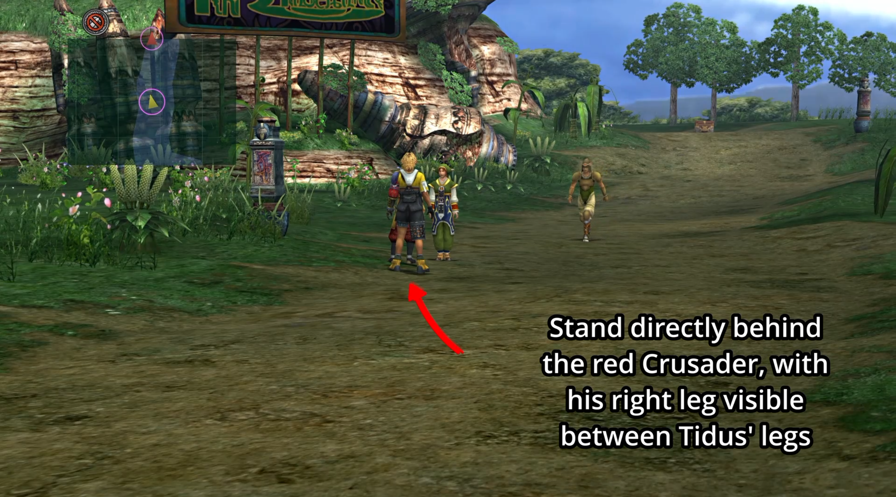

## Summary

On the final screen of Mi'ihen Highroad, at the end of the road there is a cutscene introducing Shelinda.

Much of this can be skipped if you speak to the green Crusader as you enter the cutscene, as you gain the freedom to move around while the cutscene is occurring when timed correctly.

Stand directly behind the red Crusader, with his right leg between Tidus' legs. When the walking green Crusader is parallel to the red Crusader, press Up+Right and speak to the green Crusader.

If successful, you can run north after mashing the dialogue away. Flee from any encounters.

The timing to do this on the HD Remaster is more difficult compared to PS2 as the hitbox to speak to the man in blue is substantially reduced, giving you fewer attempts to speak to him.

On PS2 also, you can prevent encounters by running when dialogue is being spoken, and stop running when there are brief pauses in the spoken dialogue, similar a 'red light, green light' game.

